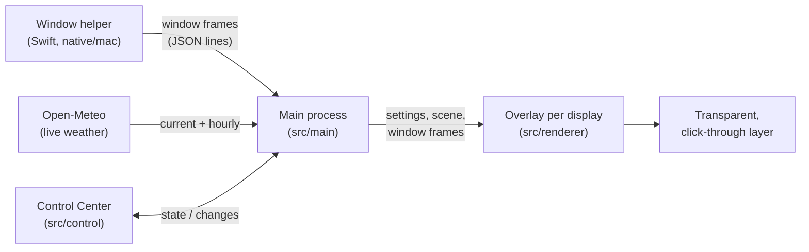

<p align="center">
  
</p>

<h1 align="center">Panefall</h1>

<p align="center">
  <b>Weather that lands on your windows.</b><br />
  Snow piles up on top of your windows, rain beads on the glass, autumn leaves settle on the ledges,<br />
  and it all tumbles off when you drag them. Or let it follow the real weather outside.
</p>

<p align="center">
  <a href="https://github.com/Rikinshah787/Panefall/releases/latest"><b>Download for macOS</b></a> ·
  <a href="https://rikinshah787.github.io/Panefall/">Website &amp; live demo</a> ·
  <a href="#build-from-source">Build from source</a>
</p>

<p align="center">
  
  
  
</p>

<p align="center">
  
</p>

## What it is

Panefall is a small desktop app that puts weather on top of your desktop, and lets that weather *interact with your windows*. It is not a wallpaper and not a screensaver. Your apps keep working underneath, clicks go straight through, and the weather never takes focus.

- **Snow** piles up on the top edge of every window, slumps into soft drifts and spills over the ends. Drag a window and the snow breaks off in clumps. When the ground gets deep, a little snowplow drives out and clears it.
- **Rain** streaks past and splashes on the ledges. Some drops land on the *glass* of your windows, bead up, merge and trickle down.
- **Storms** bring heavier rain, gusty wind and soft, occasional lightning.
- **Autumn leaves** tumble down, settle along your windows, and blow away when the wind picks up.
- **Blossoms** drift across the screen in spring.
- **Live weather** follows the real conditions in your city: rain when it rains there, snow when it snows, leaning with the real wind.
- **Your pointer is an umbrella.** Rain and snow part around it and drip off the edges, and the space underneath stays dry.

| Rain on the glass | Autumn leaves |
| --- | --- |
|  |  |

## The Control Center

Everything is in one window. Open it from the Dock, the menu bar, or with <kbd>⌃⌥O</kbd>.


- **Weather:** pick one yourself, or follow the real weather for a place you search for. You get the current conditions and the next hours at a glance.
- **Feel:** intensity, wind direction and strength, size, and how much collects.
- **On your desktop:** collect on windows, collect on the Dock, umbrella cursor, snowplow, lightning flashes, and showing over full-screen apps.
- **Utilities:**
  - temperature in the menu bar
  - a heads-up notification before rain or snow
  - pause on battery
  - a 30 fps battery-friendly mode
  - global keyboard shortcuts
  - show in the Dock or keep to the menu bar
  - open at login
  - °C or °F

Every change applies instantly.

<br clear="right" />

### Keyboard shortcuts

| Shortcut | What it does |
| --- | --- |
| <kbd>⌃⌥W</kbd> | Pause or resume the weather |
| <kbd>⌃⌥N</kbd> | Switch to the next weather |
| <kbd>⌃⌥K</kbd> | Sweep everything away |
| <kbd>⌃⌥P</kbd> | Send the snowplow |
| <kbd>⌃⌥O</kbd> | Open the Control Center |

Shortcuts can be turned off in the Control Center. If another app already uses one, the Control Center tells you.

## Install

1. Download the latest `.dmg` from [Releases](https://github.com/Rikinshah787/Panefall/releases/latest).
2. Drag **Panefall** into Applications and open it.
3. Builds are not notarized yet, so the first time macOS will refuse to open the app. Right-click it and choose **Open**, or go to **System Settings → Privacy & Security** and click **Open Anyway**.

Requires macOS 11 (Big Sur) or later. Windows support is in progress (see the [roadmap](#roadmap)).

## Permissions and privacy

- **No permissions are needed** for the weather to collect on your windows. macOS shares window positions and sizes freely. Panefall never records your screen and never sees what is inside a window.
- **Accessibility (optional):** macOS only reveals the Dock's exact size to apps with this permission. Grant it if you want snow and leaves to settle on the Dock. The Control Center has an **Allow…** button that takes you to the right place.
- **Network:** when you turn on live weather, Panefall asks [Open-Meteo](https://open-meteo.com/) for the weather at the place you picked (its latitude and longitude), and sends the place names you type into the search box. Nothing else leaves your computer: no account, no analytics, no tracking.

## Build from source

You need macOS with Xcode Command Line Tools (for `swiftc`) and Node.js 20 or later.

```sh
git clone https://github.com/Rikinshah787/Panefall.git
cd Panefall
npm install
npm start            # compiles the window helper, then launches the app
```

| Command | What it does |
| --- | --- |
| `npm start` | Build the native window helper if needed and run the app |
| `npm run dist:mac` | Package `dist/Panefall-<version>-arm64.dmg` and a `.zip` |
| `npm run demo` | Serve the repo on <http://127.0.0.1:4321>. Open `/src/renderer/` for the weather engine on a fake desktop (keys 1–6 switch weather), or `/src/control/` for the Control Center with sample data |
| `npm run site` | Copy the engine and icon into `docs/` for the website |
| `npm run site:preview` | Build and serve the website locally |
| `npm run icons` | Redraw the app and menu-bar icons from code |
| `scripts/demo-recorder.html` | Renders the animated demo above, frame by frame; see the comment at the top of `scripts/demo-recorder.js` |

To check what the app is drawing without screen-recording permission, run it with `PANEFALL_DEBUG_DIR=/some/folder npm start`. Every 10 seconds it saves an image of each overlay and of the Control Center, plus the engine's state as JSON.

> **Launching from VS Code's terminal?** VS Code sets `ELECTRON_RUN_AS_NODE=1` for its terminals, which makes Electron behave like plain Node. `npm start` clears it for you. If you run `electron .` yourself, unset it first.

## How it works



1. **It knows where your windows are.** `native/mac/WindowTracker.swift` polls `CGWindowListCopyWindowInfo` (15 times a second, 60 while something is moving) and prints the frames of on-screen windows, front to back.
2. **It simulates the weather.** `src/renderer/sim.js` is a self-contained engine with no Electron in it:
   - Each surface (a window's top edge, the Dock, the bottom of the screen) is a heightmap of 3 px columns that settles like a sandpile and tips over its ends when full.
   - Parts hidden behind windows in front are worked out from the stacking order.
   - When a window moves, what sits on it breaks loose.
   - Raindrops on the glass are tracked per window, merge, and run down in fits and starts.
3. **It draws on a clear layer.** One transparent, click-through, always-on-top window per display draws everything on a canvas, at 60 fps or 30 to save battery.

The website's hero runs the very same engine (`docs/engine/` is a copy made by `npm run site`).

### Project layout

```
native/mac/WindowTracker.swift   reports window frames (and the Dock, with Accessibility)
src/main/main.js                 app lifecycle, overlays, Control Center, menu bar, shortcuts
src/main/weather.js              Open-Meteo: place search, current weather, hourly forecast
src/main/settings.js             persisted settings with validation
src/main/mac-tracker.js          runs the native helper and parses its output
src/preload.js                   the bridge between pages and the main process
src/renderer/                    the weather engine (sim.js), snowplow (plow.js), overlay page
src/control/                     the Control Center window
docs/                            the website (GitHub Pages)
scripts/                         helper build, icon drawing, site build
```

## Roadmap

- [x] macOS: snow, rain, storms, leaves, blossoms, live weather, Control Center
- [ ] **Windows**: a Win32 window tracker (window frames and the taskbar) and an installer. The engine and the app already run on Windows; the tracker is the missing piece.
- [ ] Signed and notarized macOS builds, and a universal (Apple silicon + Intel) download
- [ ] Fog and hail
- [ ] Matching wallpapers
- [ ] Linux (X11 first)

### Ideas we're exploring

Want to pick one up? Open an issue first.

- **Focus weather.** Start a focus session and snow slowly fills your windows. When it reaches the top, it's time for a break and the snowplow clears it away.
- **Ambient sound.** Optional rain on the roof, wind and distant thunder, generated live so it never loops.
- **Forecast time-lapse.** Play the next 12 hours of your weather across the desktop in 30 seconds.
- **Weather from a friend.** Follow someone else's city and see their rain on your screen.
- **Shortcuts and automation.** A `panefall://` URL scheme for Shortcuts, Raycast and Alfred, such as `panefall://weather/rain` or `panefall://pause`.
- **Moments.** Fireworks at New Year, lanterns for Diwali, colour for Holi: opt-in, and set by your own calendar.
- **Bring your own weather.** A small plugin API so the community can add new kinds of weather.
- **Stream-friendly mode.** A transparent capture source for OBS so streamers can share the weather.

## Contributing

Ideas, bug reports and pull requests are welcome.

- **Found a bug?** Open an issue with your macOS version, your display setup and what you saw. A `PANEFALL_DEBUG_DIR` snapshot helps a lot.
- **Want to help with Windows?** The tracker needs to emit the same report as `src/main/mac-tracker.js`: `{ windows: [{ id, x, y, w, h }] front to back, menubars, dock }`. Everything else is shared.
- **Changing the engine?** You can work in the browser with `npm run demo` (open `/src/renderer/`), then run `npm run site` so the website picks up your changes.

## Credits

- Weather data by [Open-Meteo.com](https://open-meteo.com/) ([CC BY 4.0](https://creativecommons.org/licenses/by/4.0/)).
- Built with [Electron](https://www.electronjs.org/).

## License

[MIT](LICENSE) © Panefall contributors
