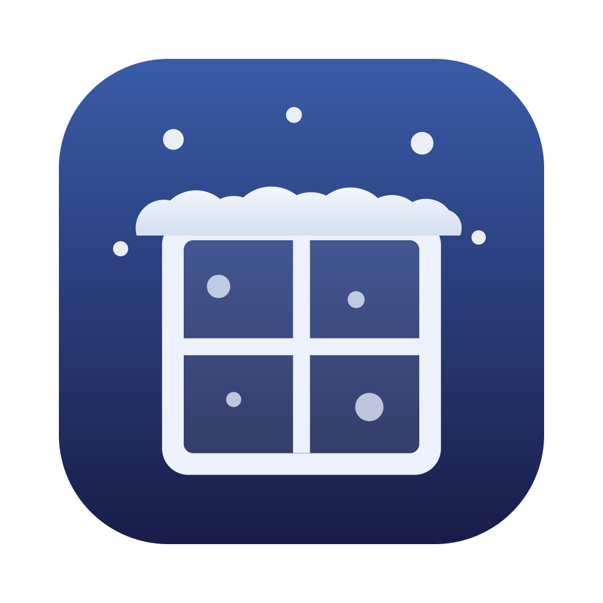
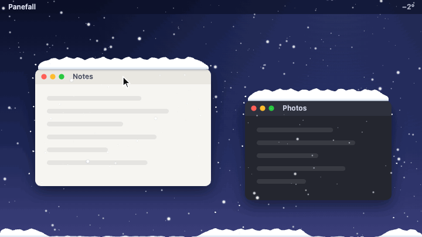
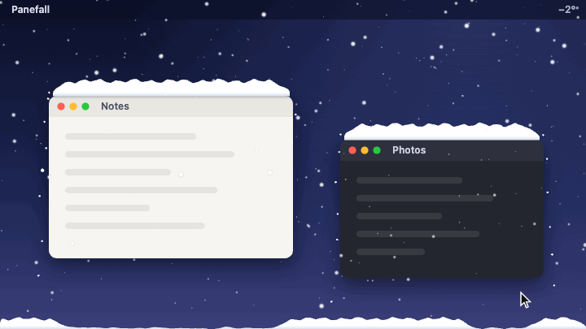
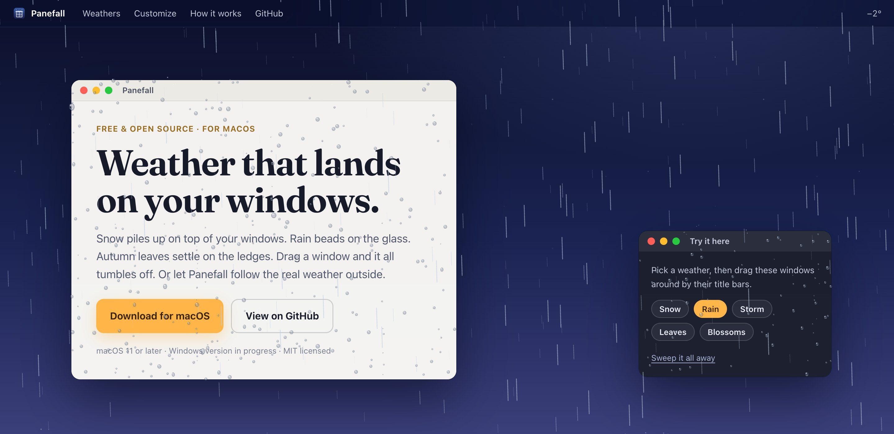
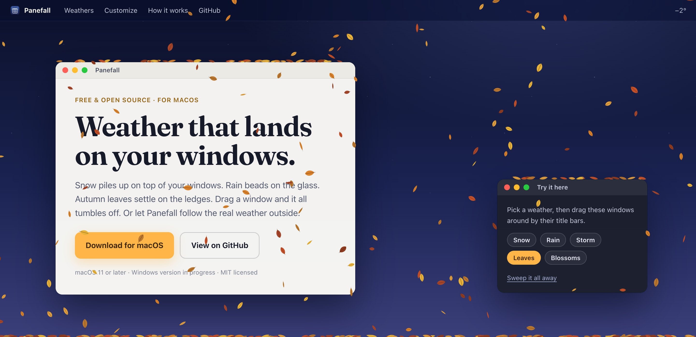
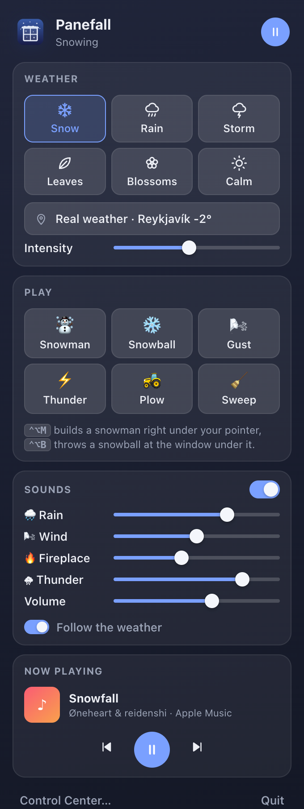
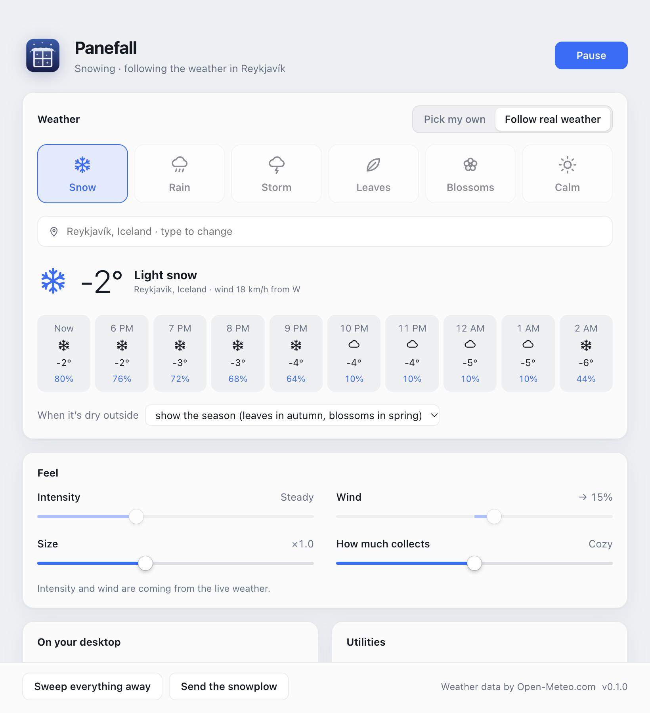
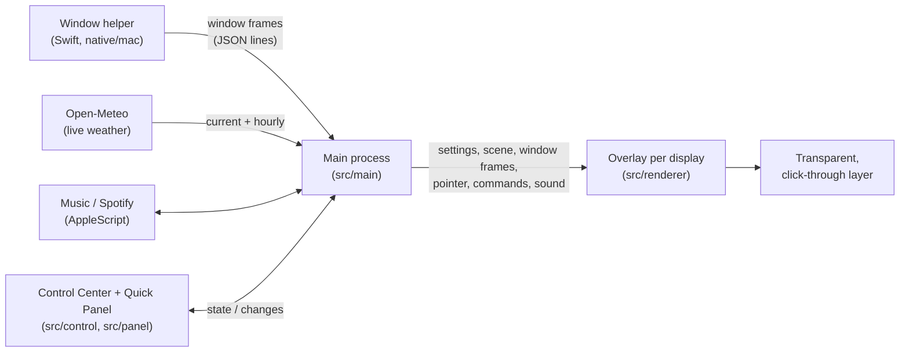

<p align="center">
  
</p>

<h1 align="center">Panefall</h1>

<p align="center">
  <b>Weather that lands on your windows.</b><br />
  Snow piles up on top of your windows, rain beads on the glass, leaves settle on the ledges,<br />
  and it all tumbles off when you drag them. Build a snowman. Throw a snowball. Follow the real weather outside.
</p>

<p align="center">
  <a href="https://github.com/Rikinshah787/Panefall/releases/latest"><b>Download for macOS</b></a> ·
  <a href="https://rikinshah787.github.io/Panefall/">Website &amp; live demo</a> ·
  <a href="#build-from-source">Build from source</a> ·
  <a href="CONTRIBUTING.md">Contribute</a>
</p>

<p align="center">
  <a href="https://github.com/Rikinshah787/Panefall/releases/latest"></a>
  
  
  <a href="LICENSE"></a>
  <a href="https://github.com/Rikinshah787/Panefall/stargazers"></a>
</p>

<p align="center">
  
</p>

## What's inside

Panefall puts weather on top of your desktop and lets it *interact with your windows*. It is not a wallpaper or a screensaver. Your apps keep working underneath, clicks go straight through, and the weather never takes focus.

| | |
| --- | --- |
| ❄️ **Snow** | Piles up on top of every window, slumps into drifts and breaks off in clumps when you drag the window. A little snowplow clears the ground. |
| 🌧 **Rain** | Streaks past and splashes on the ledges. Drops land on the *glass* of your windows, bead up, merge and trickle down. |
| ⛈ **Storm** | Heavier rain, gusty wind and soft lightning, with thunder rolling in a moment later if sound is on. |
| 🍂 **Leaves** & 🌸 **Blossoms** | Tumble down, settle along your windows and blow away when the wind picks up. |
| 📍 **Live weather** | Follows the real weather in your city: rain when it rains there, snow when it snows, leaning with the real wind. |
| ☂️ **Umbrella cursor** | Rain and snow part around your mouse pointer and drip off the edges. |
| ☃️ **Snowmen** | <kbd>⌃⌥M</kbd> and one rolls itself up under your pointer. It waves when you come near, watches your mouse, melts in the rain, and tumbles off if you move its window. |
| ❄️ **Snowballs** | <kbd>⌃⌥B</kbd> throws one at the window under your pointer. It splats on the glass and slides down. |
| 🎧 **Sounds** | Rain, wind, thunder and a crackling fireplace, generated live so they never loop, and able to follow the weather on screen. |
| 🎵 **Now playing** | Play, pause and skip Apple Music or Spotify from the Quick Panel. |

<p align="center">
  
</p>

| Rain on the glass | Autumn leaves |
| --- | --- |
|  |  |

## Quick Panel and Control Center



**Quick Panel:** click the menu-bar icon, or press <kbd>⌃⌥S</kbd>. A panel slides in from the edge of the screen with:
- the weather (or follow the real weather)
- toys: snowman, snowball, gust, thunder, snowplow, sweep
- the ambient sound mixer
- what's playing in Apple Music or Spotify

Click anywhere else and it tucks itself away. Right-click the menu-bar icon for the classic menu.

**Control Center:** everything else, in one window. Open it from the Dock, the panel, or <kbd>⌃⌥O</kbd>.
- **Weather:** pick one yourself, or search for your city to follow the real weather with an hourly forecast.
- **Feel:** intensity, wind direction and strength, size, and how much collects.
- **On your desktop:** collect on windows or the Dock, umbrella cursor, snowplow, lightning, and showing over full-screen apps.
- **Sounds:** rain, wind, fireplace and thunder levels, following the weather, and now playing.
- **Utilities:**
  - temperature in the menu bar
  - a heads-up before rain or snow
  - pause on battery
  - a 30 fps battery mode
  - global shortcuts
  - show in the Dock or menu bar only
  - open at login
  - °C or °F

<br clear="right" />

<p align="center"></p>

### Keyboard shortcuts

| Shortcut | What it does |
| --- | --- |
| <kbd>⌃⌥S</kbd> | Open the Quick Panel |
| <kbd>⌃⌥M</kbd> | Build a snowman under the pointer |
| <kbd>⌃⌥B</kbd> | Throw a snowball at the window under the pointer |
| <kbd>⌃⌥W</kbd> | Pause or resume the weather |
| <kbd>⌃⌥N</kbd> | Switch to the next weather |
| <kbd>⌃⌥K</kbd> | Sweep everything away |
| <kbd>⌃⌥P</kbd> | Send the snowplow |
| <kbd>⌃⌥O</kbd> | Open the Control Center |

Shortcuts can be turned off in the Control Center. If another app already uses one, the Control Center tells you.

## Install

1. Download the latest `.dmg` from [Releases](https://github.com/Rikinshah787/Panefall/releases/latest).
2. Drag **Panefall** into Applications and open it.
3. Builds are not notarized yet, so the first time macOS will refuse to open the app. Right-click it and choose **Open**, or go to **System Settings → Privacy & Security** and click **Open Anyway**.

Requires macOS 11 (Big Sur) or later on Apple silicon. Windows support is in progress (see the [roadmap](#roadmap)).

## Permissions and privacy

- **No permissions are needed** for weather to collect on your windows. macOS shares window positions and sizes freely. Panefall never records your screen and never sees what is inside a window.
- **Accessibility (optional):** macOS only reveals the Dock's exact size to apps with this permission. Grant it if you want snow and leaves on the Dock. The Control Center has an **Allow…** button for it.
- **Automation (optional):** the first time the Quick Panel shows what's playing, macOS asks whether Panefall may control Music or Spotify. Panefall only talks to a player that is already running, and never opens one.
- **Network:** with live weather on, Panefall asks [Open-Meteo](https://open-meteo.com/) for the weather at the place you picked (its latitude and longitude), and sends the place names you type into the search box. Nothing else leaves your computer: no account, no analytics, no tracking.

## Build from source

You need macOS with Xcode Command Line Tools (for `swiftc`) and Node.js 20 or later.

```sh
git clone https://github.com/Rikinshah787/Panefall.git
cd Panefall
npm install
npm start
```

The first `npm start` makes `build/Panefall.app`, a copy of Electron's app bundle (an instant APFS clone) renamed to Panefall with its icon. That way the menu bar, the Dock, notifications and permission prompts all say Panefall rather than Electron. The command also compiles the native window helper.

| Command | What it does |
| --- | --- |
| `npm start` | Run Panefall from source |
| `npm run dist:mac` | Package `dist/Panefall-<version>-arm64.dmg` and a `.zip` |
| `npm run demo` | Serve the repo on <http://127.0.0.1:4321>. `/src/renderer/` runs the engine on a fake desktop: keys 1–6 switch weather, and M, B, G, T build a snowman, throw a snowball, blow a gust or call thunder. `/src/control/` and `/src/panel/` show the windows with sample data |
| `npm run site` / `npm run site:preview` | Copy the engine into `docs/` for the website / build and serve it |
| `npm run icons` | Redraw the app and menu-bar icons from code |
| `scripts/demo-recorder.html` | Renders the animated demos in this README, frame by frame (see `scripts/demo-recorder.js`) |

To check what the app is drawing without screen-recording permission, run it with `PANEFALL_DEBUG_DIR=/some/folder npm start`. Every 10 seconds it saves an image of each overlay, the Control Center and the Quick Panel, plus the engine's state as JSON.

## How it works



1. **It knows where your windows are.** `native/mac/WindowTracker.swift` polls `CGWindowListCopyWindowInfo` (15 times a second, 60 while something moves) and prints the frames of on-screen windows, front to back.
2. **It simulates the weather.** `src/renderer/sim.js` is a self-contained engine with no Electron in it:
   - Each surface (a window's top edge, the Dock, the bottom of the screen) is a heightmap of 3 px columns that settles like a sandpile and tips over its ends when full.
   - Parts hidden behind windows in front are worked out from the stacking order.
   - When a window moves, what sits on it breaks loose.
   - Raindrops and snowball splats are tracked on each window's glass.
   - Snowmen stand on surfaces, and the pointer is a canopy the weather slides around.
3. **It draws on a clear layer.** One transparent, click-through, always-on-top window per display draws everything on a canvas, at 60 fps or 30 to save battery. `src/renderer/sound.js` synthesizes the ambient sound with Web Audio, from the overlay on the main display.

The website runs the very same engine (`docs/engine/` is a copy made by `npm run site`).

### Project layout

```
native/mac/WindowTracker.swift   reports window frames (and the Dock, with Accessibility)
src/main/main.js                 app lifecycle, overlays, Quick Panel, Control Center, menu bar, shortcuts
src/main/weather.js              Open-Meteo: place search, current weather, hourly forecast
src/main/media.js                now playing / play-pause / skip for Music and Spotify
src/main/settings.js             persisted settings with validation
src/main/mac-tracker.js          runs the native helper and parses its output
src/preload.js                   the bridge between pages and the main process
src/renderer/                    the weather engine (sim.js), snowplow, sound, overlay page
src/control/                     the Control Center window
src/panel/                       the Quick Panel
docs/                            the website (GitHub Pages)
scripts/                         start (named dev bundle), helper build, icons, site, demo recorder
```

## Roadmap

- [x] macOS: snow, rain, storms, leaves, blossoms, live weather
- [x] Umbrella cursor, snowmen, snowballs, gusts and thunder
- [x] Quick Panel, ambient sound and now playing
- [ ] **Windows**: a Win32 window tracker (window frames and the taskbar) and an installer. The engine and the app already run on Windows; the tracker is the missing piece.
- [ ] Signed and notarized macOS builds, and a universal (Apple silicon + Intel) download
- [ ] Fog, hail and northern lights
- [ ] Linux (X11 first)

### Ideas we're exploring

Want to pick one up? Open an issue first.

- **Focus weather.** Start a focus session and snow slowly fills your windows. When it reaches the top, it's time for a break, and the snowplow clears it away.
- **Snowball fights.** Two Macs on the same network throw snowballs at each other's windows.
- **Music-reactive weather.** Gusts on the beat, and snowfall that follows the song's energy.
- **Forecast time-lapse.** Play the next 12 hours of your weather across the desktop in 30 seconds.
- **Weather from a friend.** Follow someone else's city and see their rain on your screen.
- **Shortcuts and automation.** A `panefall://` URL scheme for Shortcuts, Raycast and Alfred, such as `panefall://snowman`.
- **Moments.** Fireworks at New Year, lanterns for Diwali, colour for Holi: opt-in.
- **Bring your own weather.** A small plugin API so the community can add new kinds of weather.

## Contributing

Ideas, bug reports and pull requests are welcome. See [CONTRIBUTING.md](CONTRIBUTING.md) for how to run, test and send changes.

## Credits

- Weather data by [Open-Meteo.com](https://open-meteo.com/) ([CC BY 4.0](https://creativecommons.org/licenses/by/4.0/)).
- Built with [Electron](https://www.electronjs.org/).

## License

[MIT](LICENSE) © Panefall contributors
